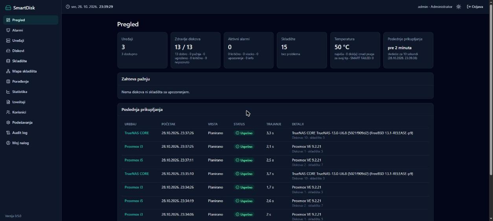
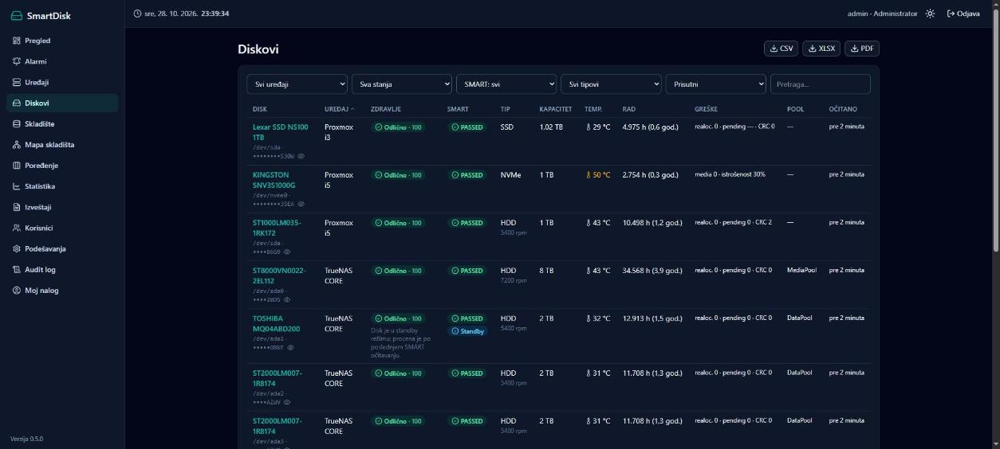
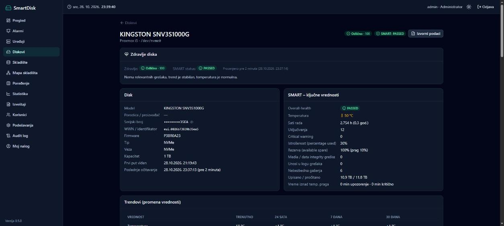
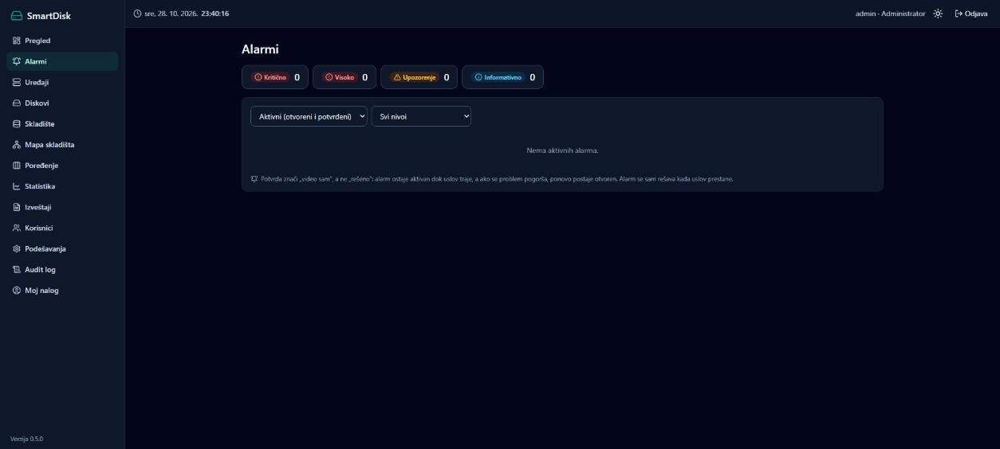
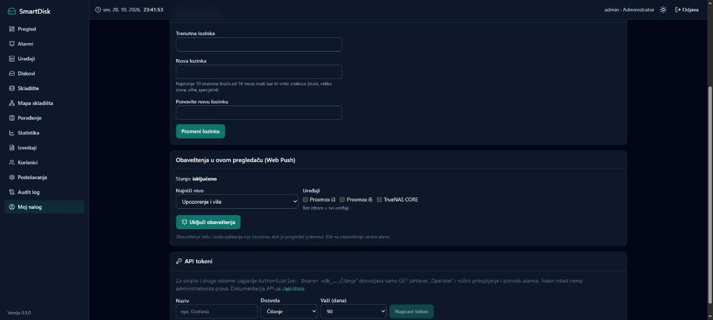
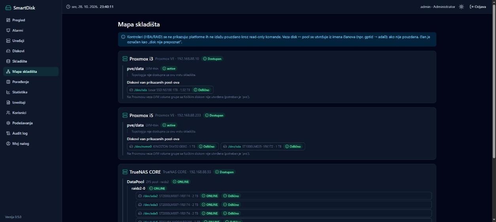
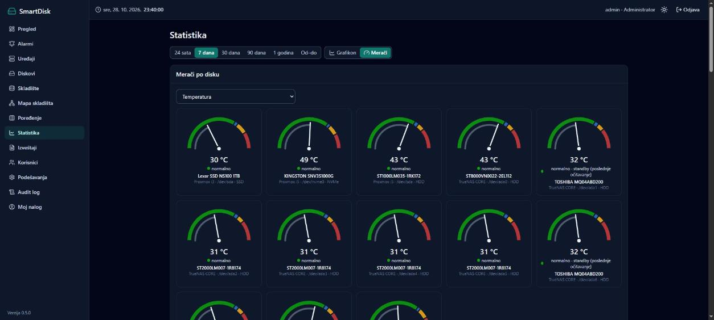
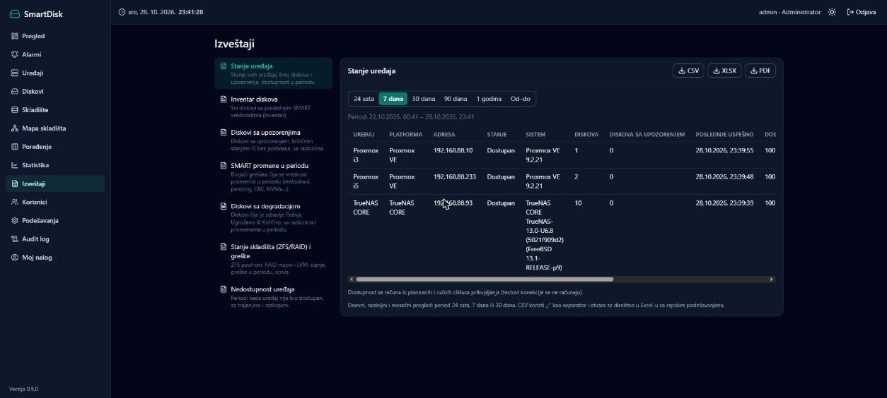
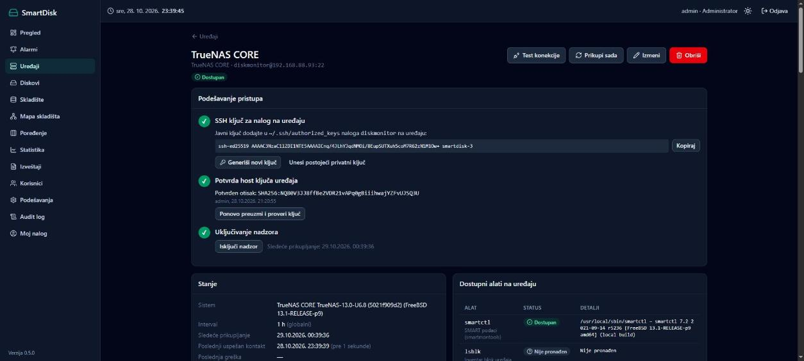
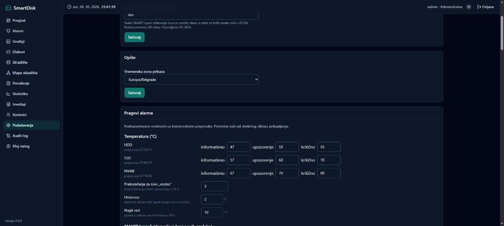

# SmartDisk - korisničko uputstvo

SmartDisk prati zdravlje diskova i skladišta na vašim serverima (TrueNAS, Proxmox VE, Synology) i na vreme upozorava kada nešto počne da se kvari. Uputstvo je pisano za korisnike koji nisu programeri i organizovano je po zadacima: pronađite šta želite da uradite i pratite korake.

Aplikacija je dostupna na adresi `https://192.168.88.246` (ili adresi koju vam je dao administrator). Ovo uputstvo je uvek dostupno i iz same aplikacije: stavka **Pomoć** u meniju.

**Sadržaj:**

1. [Prvi koraci](#1-prvi-koraci)
2. [Kako čitati stanje: boje, zdravlje, SMART](#2-kako-čitati-stanje)
3. [Pregled - svakodnevna provera](#3-pregled--svakodnevna-provera)
4. [Diskovi](#4-diskovi)
5. [Šta da radim kada disk pokaže upozorenje](#5-šta-da-radim-kada-disk-pokaže-upozorenje)
6. [Alarmi](#6-alarmi)
7. [Obaveštenja na telefon, e-poštom i u Home Assistant](#7-obaveštenja)
8. [Skladište i mapa skladišta](#8-skladište-i-mapa-skladišta)
9. [Statistika, grafikoni, merači i poređenje](#9-statistika-grafikoni-merači-i-poređenje)
10. [Izveštaji](#10-izveštaji)
11. [Uređaji: dodavanje i podešavanje](#11-uređaji-dodavanje-i-podešavanje)
12. [Podešavanja (administrator)](#12-podešavanja-administrator)
13. [Korisnici i uloge](#13-korisnici-i-uloge)
14. [Moj nalog i API tokeni](#14-moj-nalog-i-api-tokeni)
15. [Česti problemi](#15-česti-problemi)
16. [Rečnik pojmova](#16-rečnik-pojmova)

---

## 1. Prvi koraci

### Prijava

Otvorite adresu aplikacije u pregledaču i unesite korisničko ime i lozinku. Ako ste nalog dobili od administratora, aplikacija će odmah tražiti da postavite svoju lozinku (najmanje 10 znakova).

- Posle **30 minuta neaktivnosti** prijava ističe i treba se ponovo prijaviti. Najduže trajanje prijave je 12 sati.
- Posle 5 pogrešnih lozinki nalog se zaključava na 15 minuta (ili dok ga administrator ne otključa).

> Ako pregledač ili antivirus upozorava na „nepouzdan sertifikat”, administrator treba da na vaš računar instalira sertifikat aplikacije (videti [Česti problemi](#15-česti-problemi)).

### Izgled ekrana

- **Meni levo** vodi na sve delove aplikacije i stoji u mestu dok se sadržaj pomera. Pored stavke **Alarmi** stoji broj aktivnih alarma: crven kada ima visokih ili kritičnih, narandžast za upozorenja. Na telefonu se meni otvara dugmetom ☰ gore levo.
- **Zaglavlje** prikazuje datum i vreme servera, vaše ime i ulogu, prekidač svetle/tamne teme (☀/☾) i dugme **Odjava**. Ako je vreme servera netačno, pored sata piše „(NTP!)”.
- Na dnu menija je verzija aplikacije, a ispod nje logo vaše kompanije (ako ga je administrator postavio).

---

## 2. Kako čitati stanje

### Boje i oznake

Stanje se uvek prikazuje **bojom, ikonom i rečju**, pa se ne mora razlikovati samo po boji:

| Izgled | Značenje |
|---|---|
| ✔ zeleno | normalno, ispravno |
| ⓘ plavo | informacija, nešto je u toku (npr. scrub) ili disk spava |
| ⚠ žuto/narandžasto | upozorenje: treba obratiti pažnju |
| ⛔ crveno | visoko ili kritično: treba reagovati |
| ? sivo | **nema podataka**, stanje nije poznato |

### „Zdravlje diska” i SMART status nisu isto

Svaki disk ima dva pokazatelja:

- **SMART status** (PASSED / FAILED) je samoprocena diska. Disk ga sam javlja. Kada piše FAILED, disk sam predviđa kvar.
- **Zdravlje diska** je procena SmartDisk-a iz istorije: da li greške rastu, koliko brzo, kolika je temperatura, da li je disk deo oštećenog niza. Ocena je od 0 do 100.

| Zdravlje | Značenje |
|---|---|
| **Odlično** | nema grešaka, trend je stabilan, temperatura normalna |
| **Dobro** | sitni znaci habanja (npr. pojedinačne greške kabla, mnogo radnih sati) |
| **Pažnja** | prvi znaci degradacije ili povremeno povišena temperatura |
| **Ugroženo** | greške aktivno rastu: disk se kvari |
| **Kritično** | nagao rast grešaka, SMART FAILED, kritično upozorenje NVMe diska ili disk u oštećenom nizu |
| **Nepoznato** | nema dovoljno podataka |

> **Važno:** SMART **PASSED ne znači da je disk zdrav.** Disk može javljati PASSED, a da mu broj loših sektora raste iz dana u dan. Zato je pokazatelj „Zdravlje” važniji.

### „Nema grešaka” nije isto što i „nema podataka”

Kada aplikacija ne može da pročita disk (uređaj je nedostupan, kontroler ne prosleđuje SMART, disk je izvađen), prikazuje se **siva oznaka „Nema podataka” / „Nepoznato”**, nikad zelena. Prazno polje ili „-” u tabeli znači „vrednost nije dostupna”, a ne 0.

### Disk u standby-ju

Diskovi koji se uspavaju (najčešće HDD u NAS-u) dobijaju plavu oznaku **Standby**. SmartDisk ih namerno ne budi, da ne bi trošio disk i struju. Za takav disk se prikazuju vrednosti iz **poslednjeg** očitavanja dok je bio budan, uz napomenu.

---

## 3. Pregled - svakodnevna provera

Stranica **Pregled** je prva stranica posle prijave. Za dnevnu proveru dovoljno je pogledati:

1. **Zdravlje diskova:** koliko diskova je u dobrom stanju od ukupnog broja (npr. 13 / 13).
2. **Aktivni alarmi:** broj po nivoima. Klik vodi na listu alarma.
3. **Zahteva pažnju:** spisak diskova i skladišta sa problemom. Ako piše „Nema diskova ni skladišta sa upozorenjem”, sve je u redu.
4. **Temperatura:** najviša trenutna temperatura i broj diskova iznad praga za svoj tip.
5. **Poslednje prikupljanje:** kada su podaci poslednji put osveženi i kada je sledeće očitavanje.
6. **Najnoviji događaji** i **Poslednja prikupljanja:** šta se skoro dešavalo.

Ako se pojavi crveni okvir „Scheduler ne radi” ili „Server nije dostupan”, podaci se ne osvežavaju. Javite administratoru.

---

## 4. Diskovi

### Lista svih diskova

Meni **Diskovi** prikazuje sve diskove sa svih uređaja.

- **Filteri** iznad tabele: uređaj, zdravlje, SMART status, tip diska (HDD, SSD, NVMe…), prisutni ili nestali diskovi i pretraga po modelu, putanji ili pool-u.
- Klik na **naslov kolone** sortira tabelu (ponovni klik obrće redosled). Npr. klik na „Zdravlje” stavlja najugroženije diskove na vrh.
- Serijski brojevi su **skriveni** (vide se samo poslednja 4 znaka). Ikona oka ih otkriva.
- **Izvoz** (CSV, XLSX, PDF) je gore desno.

### Stranica jednog diska

Klik na model diska otvara njegovu stranicu:

- **Zdravlje diska:** nivo, ocena, **razlozi** i **preporuka** šta uraditi.
- **Disk:** model, proizvođač, serijski broj, kapacitet, tip, veza, kada je prvi put viđen.
- **SMART - ključne vrednosti:** temperatura, radni sati, loši sektori (HDD/SSD) ili istrošenost i rezerva (NVMe). Broj veći od nule kod brojača grešaka je istaknut crveno.
- **Trendovi:** koliko se svaka vrednost promenila za 24 sata, 7 dana i 30 dana. Rast brojača grešaka je istaknut crveno.
- **Grafikoni i statistika:** izaberite period (24 sata … 1 godina ili od-do) i vrednost (temperatura, sati rada, sektori…). Ispod grafikona su minimum, maksimum, prosek i brzina promene. Trouglić ▲ na grafikonu označava trenutak kada je alarm prvi put otkriven.
- **Prognoze:** procena kada bi vrednost mogla dostići granicu (npr. istrošenost NVMe diska 100 %). Ovo je procena, ne dijagnoza; pogledajte oznaku kvaliteta.
- **SMART atributi:** svi atributi koje disk javlja. Raw vrednosti različitih proizvođača nisu iste jedinice.
- **SMART self-testovi:** rezultati testova iz loga diska (SmartDisk testove ne pokreće).
- **Istorija očitavanja** i dugme **Izvorni podaci** (kompletan izlaz alata smartctl, za stručnu proveru).

---

## 5. Šta da radim kada disk pokaže upozorenje

1. Otvorite stranicu diska i pročitajte **Razlozi** i **Preporuka** u kartici „Zdravlje diska”.
2. Pogledajte **Trendove**: da li greške rastu (+ u kolonama 24 h / 7 dana) ili su stabilne?
3. Postupite po nivou:

| Zdravlje | Šta uraditi |
|---|---|
| **Dobro** zbog CRC grešaka | Najčešće je kriv kabl ili konektor, ne disk. Proverite ili zamenite SATA kabl. |
| **Pažnja** | Pratite disk narednih dana. Proverite da li imate ažurnu rezervnu kopiju podataka. |
| **Ugroženo** | Ne stavljajte nove važne podatke na disk. Nabavite zamenski disk. Proverite rezervnu kopiju. |
| **Kritično** | Odmah proverite rezervnu kopiju i zamenite disk što pre. Ako je disk u ZFS/RAID nizu, posle zamene pratite resilver/rebuild na stranici Skladište. |
| **Nepoznato** | Proverite da li je uređaj dostupan i da li disk podržava SMART (videti [Česti problemi](#15-česti-problemi)). |

4. Ako je disk deo ZFS pool-a ili RAID niza, proverite stanje niza na stranici **Skladište**.

> SmartDisk **nikad ništa ne menja** na vašim serverima: ne izbacuje diskove, ne pokreće scrub ni testove. Zamena diska se uvek radi ručno, kroz TrueNAS, Proxmox ili Synology.

Za vreme zamene diska uključite **režim održavanja** (Podešavanja → Režim održavanja), da ne stižu nepotrebna obaveštenja.

---

## 6. Alarmi

Alarm nastaje automatski kada se pojavi problem: rast loših sektora, visoka temperatura, nedostupan uređaj, oštećen pool, disk koji je nestao, novi ili zamenjen disk, netačno vreme servera, neuspeo backup…

### Nivoi

| Nivo | Primer |
|---|---|
| **Informativno** | nove CRC greške, temperatura blizu praga, nov disk pronađen |
| **Upozorenje** | pending sektori, temperatura iznad praga, NVMe istrošen 80 % |
| **Visoko** | više novih loših sektora u 24 h, ponovljeno pregrevanje, nedostupan uređaj, nestao disk |
| **Kritično** | SMART FAILED, kritično upozorenje NVMe diska, neispravljivi sektori u porastu, disk sa problemom u oštećenom nizu |

### Rad sa alarmima

- **Lista** (meni Alarmi): kartice na vrhu prikazuju broj po nivoima, a klik filtrira listu. Izbor statusa: aktivni, samo otvoreni, potvrđeni, rešeni ili svi.
- **Potvrdi** znači „video sam, radim na tome”. Potvrđen alarm **ostaje aktivan** dok problem traje. Ako se problem pogorša, alarm se ponovo otvara i ponovo šalje obaveštenje.
- **Komentar**: na stranici alarma upišite šta ste uradili (npr. „naručen novi disk”). Komentari ostaju u istoriji alarma.
- **Zatvori**: ručno zatvaranje. Ako problem i dalje postoji, alarm se ponovo otvara pri sledećem očitavanju.
- Alarm se **sam rešava** kada problem nestane (npr. temperatura padne).
- Stranica alarma prikazuje i **istoriju** (kada je otvoren, eskaliran, potvrđen, rešen) i **poslata obaveštenja**.

Potvrđivanje i zatvaranje mogu Administrator i Operater. Korisnik sa ulogom „Pregled” samo gleda.

---

## 7. Obaveštenja

Obaveštenja o alarmima mogu stizati na više načina. Svaki se uključuje posebno.

### U pregledaču (Web Push) - svaki korisnik za sebe

1. Otvorite **Moj nalog** → kartica **Obaveštenja u ovom pregledaču**.
2. Izaberite najniži nivo (npr. „Upozorenje i više”) i, po želji, samo neke uređaje.
3. Kliknite **Uključi obaveštenja** i u pregledaču odobrite obaveštenja (**Allow / Dozvoli**).
4. **Pošalji probu** proverava da obaveštenja stižu.

Obaveštenja stižu i kada SmartDisk nije otvoren, dok je pregledač pokrenut. Klik na obaveštenje otvara alarm. **Utišaj 8 h** privremeno zaustavlja obaveštenja u tom pregledaču. Podešavanje važi za taj pregledač i uređaj; na telefonu ga treba posebno uključiti.

### E-pošta, Telegram, Pushover, Home Assistant (podešava administrator)

U **Podešavanjima** administrator podešava:

- **E-poštu (SMTP)**: server, nalog, primaoce i najniži nivo. Dugme **Pošalji probnu poruku** proverava podešavanje.
- **MQTT i Home Assistant**: SmartDisk se sam pojavljuje u Home Assistant-u kao uređaj sa senzorima (temperature, zdravlje, alarmi…). Za automatizacije se koristi tema `diskmonitor/events`.
- **Telegram, Pushover, webhook**: dodatni kanali, svaki sa probnim slanjem.

Detaljno tehničko uputstvo za ove kanale je u dokumentu *Obaveštenja* (`docs/obavestenja.md`).

---

## 8. Skladište i mapa skladišta

### Skladište

Meni **Skladište** prikazuje ZFS pool-ove (TrueNAS, Proxmox), RAID nizove (Synology, mdadm), LVM i Proxmox storage, grupisano po uređaju. Za svaki se vide:

- **stanje** (ONLINE, DEGRADED…) i zauzeće (traka postaje narandžasta od 80 % i crvena od 90 %);
- **greške** čitanja, pisanja i kontrolnih suma (READ/WRITE/CKSUM): sve bi trebalo da budu 0;
- **scrub** (redovna provera podataka): kada je završen i sa koliko grešaka; tokom scrub-a ili resilver-a vidi se napredak u procentima;
- **članovi** niza, sa stanjem svakog diska (klik na disk otvara njegovu stranicu).

Upozorenje **„Pool nema redundansu”** znači da kvar bilo kog diska u tom pool-u uništava sve podatke u njemu. To nije kvar, nego način na koji je pool napravljen. Takvi podaci moraju imati rezervnu kopiju.

Klik na ime pool-a otvara njegovu **istoriju**: grafikone zauzeća, slobodnog prostora i grešaka kroz vreme.

### Mapa skladišta

**Mapa skladišta** prikazuje celu strukturu na jednom mestu: uređaj → pool → grupa diskova (npr. raidz2) → diskovi, sa stanjem i zdravljem svakog dela.

---

## 9. Statistika, grafikoni, merači i poređenje

### Statistika

Gore se bira **period** (24 sata, 7, 30, 90 dana, 1 godina ili **Od-do** sa tačnim datumima) i **način prikaza**:

- **Grafikon**: poređenje do 8 diskova kroz vreme za izabranu vrednost. Diskovi se biraju u listi levo; svaki disk ima svoju boju i zadržava je. Pomeranje miša preko grafikona prikazuje tačne vrednosti. Krajevi donje trake služe za zumiranje. Dugme **Tabela** prikazuje iste podatke kao tabelu, a **CSV/XLSX** ih preuzima. Interval (sirovo, satno, dnevno, nedeljno) bira se pored perioda.
- **Merači**: za svaki disk po jedan merač izabrane vrednosti (npr. temperature), sa zonama: zeleno normalno, plavo blizu praga, žuto iznad praga, crveno kritično. Pragovi su različiti za HDD, SSD i NVMe.

Ispod su **Prognoze** (procena kada će se pool napuniti ili SSD istrošiti, sa oznakom kvaliteta: „nepouzdano” dok nema bar 7 dana podataka), temperature u periodu, diskovi sa najviše radnih sati, najveća istrošenost SSD-ova, trend zauzeća skladišta i dostupnost uređaja.

### Poređenje diskova

**Poređenje** postavlja do 6 diskova jedan pored drugog: tip, kapacitet, zdravlje, temperatura, radni sati, greške i zajednički SMART atributi. Diskovi se biraju iz padajućih lista na vrhu.

---

## 10. Izveštaji

1. Levo izaberite izveštaj:
   - **Stanje uređaja**: svi uređaji, broj diskova i upozorenja, dostupnost.
   - **Inventar diskova**: svi diskovi sa vrednostima.
   - **Diskovi sa upozorenjima**: šta treba proveriti.
   - **Diskovi sa degradacijom**: diskovi u stanju Pažnja, Ugroženo ili Kritično, sa razlozima.
   - **SMART promene u periodu**: koji su brojači grešaka porasli.
   - **Stanje skladišta i greške**: pool-ovi i nizovi.
   - **Nedostupnost uređaja**: kada i koliko dugo uređaj nije bio dostupan.
2. Izaberite period: 24 sata (dnevni), 7 dana (nedeljni), 30 dana (mesečni) ili od-do. Po potrebi izaberite i uređaj.
3. Pregled je na ekranu; dugmad **CSV**, **XLSX** i **PDF** preuzimaju izveštaj. CSV se otvara direktno u Excel-u.

Administrator može podesiti da izveštaji **stižu sami e-poštom** (Podešavanja → Zakazani izveštaji): dnevno, nedeljno ili mesečno, u izabranom formatu.

---

## 11. Uređaji: dodavanje i podešavanje

Meni **Uređaji** prikazuje sve nadzirane servere, sa stanjem, brojem diskova i upozorenja, intervalom i vremenom sledećeg očitavanja. **Prikupi sada** odmah osvežava podatke uređaja.

Dodavanje uređaja radi administrator, a za pripremu servera potreban je pristup njemu (nalog `diskmonitor`). Tačni koraci za svaku platformu su u dokumentu *Dodavanje uređaja* (`docs/dodavanje-uredjaja.md`), a ukratko:

1. Na serveru napraviti nalog `diskmonitor` sa ograničenim pravima (spisak komandi aplikacija prikazuje na stranici uređaja, kartica **Profil privilegija**).
2. **Uređaji → Dodaj uređaj**: naziv, platforma, IP adresa, korisnik `diskmonitor`.
3. Na stranici uređaja pratiti tri koraka:
   1. **Generiši ključ** pa javni ključ dodati na server;
   2. **Preuzmi otisak host ključa**, uporediti ga sa otiskom na samom serveru i tek tada potvrditi;
   3. **Test konekcije**, pa **Uključi nadzor**.

Na stranici uređaja su još: stanje i poslednja greška, dostupni alati, diskovi i skladište tog uređaja, **dostupnost** kroz vreme (sa periodima kada uređaj nije odgovarao) i istorija prikupljanja. Status prikupljanja **Delimično** znači da je veza uspela, ali deo podataka nije pročitan (najčešće nedostaje dozvola za neku komandu; razlog piše u istoriji).

Brisanje uređaja ne briše istoriju njegovih diskova.

---

## 12. Podešavanja (administrator)

| Kartica | Šta se podešava |
|---|---|
| **Prikupljanje podataka** | koliko često se čitaju uređaji (globalni interval) i koliko dugo se čuvaju detaljna merenja (podrazumevano 365 dana; dnevni proseci ostaju i posle toga) |
| **Opšte** | vremenska zona prikaza |
| **Izgled - logo kompanije** | logo na dnu menija (PNG, JPEG ili WebP do 512 KB; širok logo sa providnom pozadinom izgleda najbolje) i naziv kompanije. **Ukloni logo** ga briše |
| **Pragovi alarma** | temperature po tipu diska, dozvoljen broj novih grešaka, granice za SSD/NVMe i zauzeće, koliko neuspelih očitavanja znači „nedostupan”, ponovno obaveštavanje. **Vrati preporučene** vraća podrazumevane vrednosti |
| **E-pošta (SMTP)**, **MQTT i Home Assistant**, **Dodatni kanali** | kanali obaveštenja, svaki sa probom |
| **Opšte za obaveštenja** | adresa aplikacije za linkove u porukama, obaveštenje kada se alarm reši |
| **Evidencija obaveštenja** | šta je poslato, kome i da li je uspelo |
| **Vreme i NTP** | da li je sat servera tačan i prema kom NTP serveru se proverava |
| **Režim održavanja** | na nekoliko sati šalju se samo kritična obaveštenja (npr. tokom zamene diska) |
| **Zakazani izveštaji** | automatsko slanje izveštaja e-poštom; **Pošalji sada** za proveru |
| **Backup baze** | svakodnevni backup u izabrani sat, broj čuvanih kopija, **Napravi backup sada**. Backup ne sadrži glavni ključ aplikacije, koji administrator čuva odvojeno |
| **Stanje aplikacije** | verzija, rad scheduler-a, veličina baze, slobodan prostor |

**Audit log** (meni) beleži svaku važnu radnju: prijave, izmene uređaja, korisnika i podešavanja, potvrde alarma, backup.

- Za svaku **prijavu**, uspešnu i neuspešnu, beleže se rezultat i razlog (pogrešna lozinka, nepostojeći korisnik, zaključan nalog, previše pokušaja) i podaci o računaru: IP adresa, ime računara (ako ga lokalni DNS zna), pregledač i verzija, operativni sistem (razlikuje i Windows 10 od 11), vrsta uređaja, ekran, jezik, vremenska zona i broj procesorskih jezgara.
- **Klik na red** otvara prozor sa svim detaljima zapisa.
- Filter **Samo neuspešne prijave** brzo pokazuje pokušaje sa pogrešnom lozinkom.
- MAC adresa i korisničko ime na računaru nisu dostupni web aplikaciji. Lozinka se nikad ne upisuje u log.

---

## 13. Korisnici i uloge

| Uloga | Može |
|---|---|
| **Administrator** | sve: uređaji, korisnici, podešavanja, audit log |
| **Operater** | sve preglede, ručno prikupljanje, test konekcije, potvrdu, komentare i zatvaranje alarma |
| **Pregled** | samo gledanje podataka, izveštaja i alarma |

Administrator u meniju **Korisnici** pravi naloge, menja uloge, postavlja novu lozinku (korisnik je menja pri prvoj prijavi), otključava zaključan nalog i odjavljuje sve sesije korisnika. Poslednji aktivni administrator ne može biti uklonjen.

---

## 14. Moj nalog i API tokeni

U **Moj nalog** su vaši podaci, promena lozinke, obaveštenja u pregledaču ([odeljak 7](#7-obaveštenja)) i **API tokeni**.

API token služi drugim programima (npr. Grafana, skripta) za čitanje podataka bez lozinke:

1. Upišite naziv, izaberite dozvolu (**Čitanje** ili **Operater**) i rok važenja, pa kliknite **Napravi token**.
2. Token se prikazuje **samo jednom**: kopirajte ga odmah i čuvajte kao lozinku.
3. Token koji više ne treba **opozovite**.

Token nikad nema administratorska prava. Opis API-ja je na adresi `/api/docs`.

---

## 15. Česti problemi

| Problem | Uzrok i rešenje |
|---|---|
| Pregledač ili antivirus (npr. Kaspersky) upozorava na nepouzdan sertifikat ili blokira stranicu | Na računar treba instalirati sertifikat aplikacije (*SmartDisk-CA.crt*): dvoklik → *Install Certificate* → *Local Machine* → *Trusted Root Certification Authorities*, pa ponovo pokrenuti pregledač. Postupak je u `docs/instalacija.md`. |
| „Sesija je istekla. Prijavite se ponovo.” | Prošlo je 30 minuta bez aktivnosti. Prijavite se ponovo. |
| Nalog je zaključan | Posle 5 pogrešnih lozinki: sačekajte 15 minuta ili zamolite administratora da ga otključa. |
| Uređaj ima status **Greška** ili alarm „uređaj nije dostupan” | Server je ugašen, mreža ne radi ili je promenjen SSH. Poruka greške na stranici uređaja govori šta tačno: „Konekcija je odbijena” (SSH ne radi), „Isteklo je vreme” (mreža), „Host ključ se ne poklapa” (server je reinstaliran: ključ treba ponovo proveriti i potvrditi). |
| Prikupljanje je **Delimično** | Veza radi, ali neka komanda nije dozvoljena (najčešće sudo). Administrator proverava profil privilegija na stranici uređaja. |
| Disk ima **Nepoznato** / „SMART nedostupan” | Kontroler ili USB kućište ne prosleđuje SMART podatke. Disk se i dalje vidi u inventaru, ali mu se zdravlje ne može proceniti. |
| Disk stalno prikazuje **Standby** | Disk spava i SmartDisk ga namerno ne budi. Vrednosti su iz poslednjeg očitavanja dok je bio budan. |
| Disk je nestao iz liste | U filteru izaberite „Prisutni i nestali”. Nestali disk ostaje sa celom istorijom, a o nestanku postoji alarm. |
| Ne stižu obaveštenja u pregledaču | Proverite *Moj nalog → Obaveštenja* (stanje, utišavanje, najniži nivo), dozvolu u pregledaču (ikona katanca u adresnoj traci) i obaveštenja za pregledač u Windows-u. Tokom **režima održavanja** stižu samo kritična obaveštenja. |
| Ne stiže e-pošta | Administrator: Podešavanja → E-pošta → **Pošalji probnu poruku**; greška kaže šta nije u redu (lozinka, port, server). |
| Pored sata piše „(NTP!)” | Sat servera nije tačan. Ispravlja se NTP-om na Proxmox hostu; detalji su u Podešavanja → Vreme i NTP. |
| Prognoza piše „Nepouzdano” | Još nema dovoljno istorije (bar 7 dana i 10 očitavanja). Procena postaje pouzdanija vremenom. |
| Na stranici je crveni okvir „Scheduler ne radi” | Podaci se ne prikupljaju. Administrator treba da proveri servis `smartdisk-api`. |

---

## 16. Rečnik pojmova

| Pojam | Objašnjenje |
|---|---|
| **SMART** | samodijagnostika ugrađena u diskove; disk beleži greške, temperaturu, radne sate |
| **Realocirani sektori** | loša mesta na disku koja je disk zamenio rezervnim. Pojedinačni i stabilni nisu alarmantni, ali **rast** jeste |
| **Pending sektori** | mesta koja disk trenutno ne može pouzdano da pročita; često prethode realokaciji |
| **Neispravljivi sektori** | podaci koji nisu mogli biti pročitani ni ispravljeni; moguć gubitak podataka |
| **CRC greške** | greške u prenosu podataka kroz kabl ili konektor, obično ne znače da je disk loš |
| **NVMe istrošenost** | procenat iskorišćenog predviđenog veka NVMe SSD-a (100 % = dostignut predviđeni vek) |
| **NVMe rezerva** | preostali rezervni prostor za zamenu istrošenih ćelija |
| **Pool / niz** | više diskova udruženih u jedno skladište (ZFS pool, RAID, SHR) |
| **raidz / mirror** | načini udruživanja koji podnose kvar jednog ili više diskova bez gubitka podataka |
| **Stripe / bez redundanse** | diskovi spojeni bez zaštite: kvar jednog znači gubitak svih podataka |
| **Scrub** | redovna provera svih podataka u pool-u; greške u scrub-u znače oštećene podatke |
| **Resilver / rebuild** | obnova podataka na novi disk posle zamene |
| **DEGRADED** | niz radi, ali je izgubio zaštitu (neki disk ne radi) |
| **Standby** | disk je uspavan radi uštede |
| **Interval prikupljanja** | koliko često SmartDisk čita podatke sa uređaja |
| **NTP** | usluga za tačno vreme; tačno vreme je važno za trendove i alarme |
| **Režim održavanja** | privremeno slanje samo kritičnih obaveštenja |
